# Hammer CTF — Authentication Bypass, JWT Privilege Escalation, and Flag Retrieval

## Overview

- **Challenge:** Hammer
- **Platform:** TryHackMe
- **Target:** Assigned CTF lab machine (authorized environment only)
- **Primary areas:** Web enumeration, password recovery, rate limiting, JWT security, authorization, and command execution
- **Objective:** Obtain both flags — the dashboard flag and the contents of `/home/ubuntu/flag.txt`

Difficulty, completion date, and other challenge metadata are omitted because they were not verified in the supplied evidence.

## Table of Contents

1. [Lab Setup and Scope](#lab-setup-and-scope)
2. [Initial Reconnaissance](#initial-reconnaissance)
3. [Directory Enumeration and Information Disclosure](#directory-enumeration-and-information-disclosure)
4. [Password Recovery and Rate-Limit Analysis](#password-recovery-and-rate-limit-analysis)
5. [First Flag — Dashboard Access](#first-flag--dashboard-access)
6. [Dashboard Command Functionality](#dashboard-command-functionality)
7. [JWT Analysis](#jwt-analysis)
8. [Signing-Key Discovery](#signing-key-discovery)
9. [Privilege Escalation — User to Administrator](#privilege-escalation--user-to-administrator)
10. [Second Flag — File Retrieval](#second-flag--file-retrieval)
11. [Complete Attack Chain](#complete-attack-chain)
12. [Vulnerabilities and Remediation](#vulnerabilities-and-remediation)
13. [Lessons Learned](#lessons-learned)
14. [Conclusion](#conclusion)
15. [Disclaimer](#disclaimer)

---

## Lab Setup and Scope

- **Testing environment:** Kali Linux (inferred from the supplied shell screenshots; not independently verified).
- **Target:** The assigned TryHackMe lab machine. The supplied notes and screenshots reference more than one IP address (for example `10.48.141.153`, `10.49.144.218`, and `10.10.63.156`). These appear to come from different lab instances or sessions. Each phase below uses the address shown in its own evidence; the addresses are not silently combined into a single target.
- **Tools observed in the evidence:** Nmap, `dirsearch`, browser Developer Tools, Burp Suite, a JWT decoder (jwt.io), and a Python recovery-code testing script.
- **Scope:** Authorized TryHackMe CTF lab only. Do not run these techniques against systems without explicit permission.

Placeholders such as `<TARGET_IP>` are used where a value could not be verified.

---

## Initial Reconnaissance

1. Identify the assigned target machine.
2. Run an Nmap scan against it.
3. The supplied notes report **three open ports**, with port `1337` standing out as the likely web application.
4. Perform service/version detection.
5. Investigate the web service on port `1337`.
6. Open the web application in a browser.
7. Inspect the login page and its page source.

```bash
nmap -sC -sV -oN nmap-initial.txt <TARGET_IP>
```

- `-sC` runs Nmap's default scripts.
- `-sV` attempts to identify service versions.
- `-oN` saves the results to a text file.

**Observation:** port `1337` was identified as the web application entry point and was used for all subsequent web testing. The names of the other two open ports and their service versions are not included in the supplied evidence and are not fabricated here.

The page source referenced resource paths beginning with `hmr_`, which provided a useful lead for content discovery.


*Figure 9: Browser DevTools sources panel used while inspecting the application's `hmr_` resources. An alternate capture of the same view is shown in Figure 10.*


*Figure 10: Alternate capture of the same DevTools sources view.*

---

## Directory Enumeration and Information Disclosure

The `hmr_` resource naming pattern observed in the page source was used as a lead for directory enumeration. A directory-discovery tool was run against the web service:

```bash
dirsearch -u http://<TARGET_IP>:1337/ -w <WORDLIST_PATH>
```

The notes report discovery of the following paths:

- `/hmr_css`
- `/hmr_images`
- `/hmr_js`
- `/hmr_logs`

Browsing the discovered paths revealed `hmr_logs/error.logs`, which contained application error messages and the account email address:

```
tester@hammer.thm
```

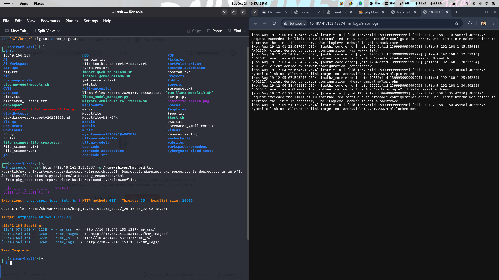

*Figure 1: dirsearch results revealing the `hmr_` paths and the exposed `hmr_logs/error.logs` containing the account email and internal path details.*

**Why this mattered:** the log disclosure revealed a valid account identifier that could be used in the password-reset workflow. Exposed application logs can disclose useful information to an attacker, including account identifiers, internal paths, and configuration details. Error logs should not be publicly accessible in a production application.

---

## Password Recovery and Rate-Limit Analysis

### Discovered account

The email discovered in the error log was:

```
tester@hammer.thm
```

### Recovery page

Returning to the login page, selecting **Forgot your password?**, and submitting the discovered email started the password-reset flow. The reset page requested a **four-digit recovery code** and displayed a countdown of roughly **180 seconds**.

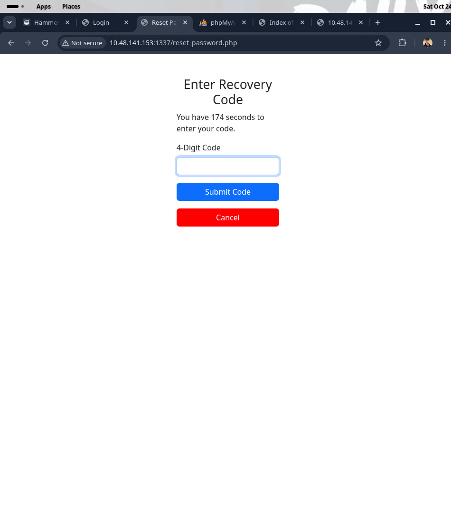

*Figure 2: Reset page requesting the four-digit recovery code with the ~180-second countdown.*

### Rate-limit investigation

Submitting a test code and inspecting the request in the browser's Developer Tools Network panel showed the request was handled by `reset_password.php`. The supplied notes report a rate-limit allowance of **nine attempts**.


*Figure 3: Browser DevTools Network tab showing the `reset_password.php` request and rate-limit headers (sensitive values redacted).*

This indicated two constraints to investigate in the authorized lab:

- The recovery code had a short validity period.
- Repeated guesses were rate limited.

The significance of client-controlled forwarding headers was examined in the context of the observed application behavior: the target accepted the `X-Forwarded-For` header for rate-limit accounting.

### Controlled recovery-code testing

The notes describe a Python script that submitted candidate four-digit codes and varied the `X-Forwarded-For` request header within the `127.0.0.0/8` range. The target accepted this header for rate-limit accounting, allowing the challenge's rate limit to be bypassed. The script completed before the recovery-code window expired and set the new password to `Password123`.

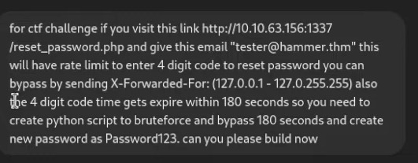

*Figure 4: The prompt supplied to build the recovery-code brute-force script (password value redacted in the published capture where applicable).*

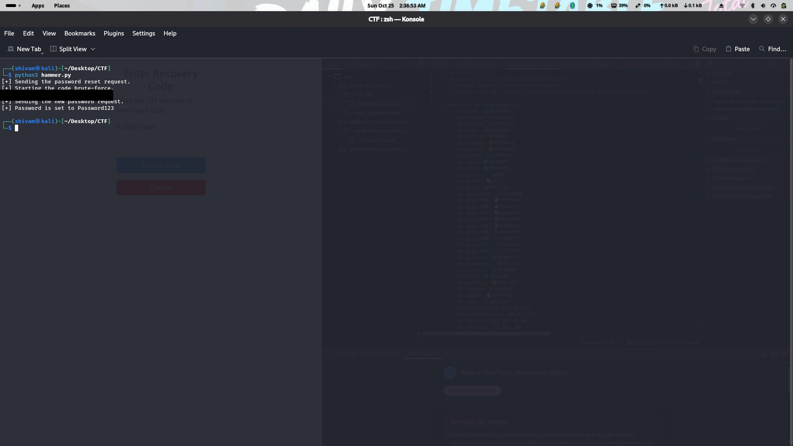

*Figure 11: Final output of the recovery script, showing the recovered code and the password-reset result (sensitive values redacted).*

**Result reported in the notes:** the script found the recovery code, and the password was reset successfully.

**Security lesson:** `X-Forwarded-For` is user-controllable unless a trusted reverse proxy removes and rewrites it. Applications must not trust arbitrary client-supplied forwarding headers to determine rate-limit identity. Apply limits using a trusted client identity and account-level controls, and add monitoring and lockout protections appropriate to the threat model. Forwarding headers must only be trusted when correctly set by a trusted reverse proxy.

> For a public write-up, avoid publishing a reusable brute-force script or a live recovery code. The flaw and the observed result are explained here; any exploit implementation should remain limited to the isolated CTF environment.

---

## First Flag — Dashboard Access

Returning to the login page and authenticating with:

- **Email:** `tester@hammer.thm`
- **Password:** `Password123` (the password set during the lab workflow)

the dashboard welcomed the user as **Thor** and displayed the first flag:

```
THM{AuthBypass3D}
```


*Figure 12: Dashboard greeting Thor and displaying `THM{AuthBypass3D}`.*

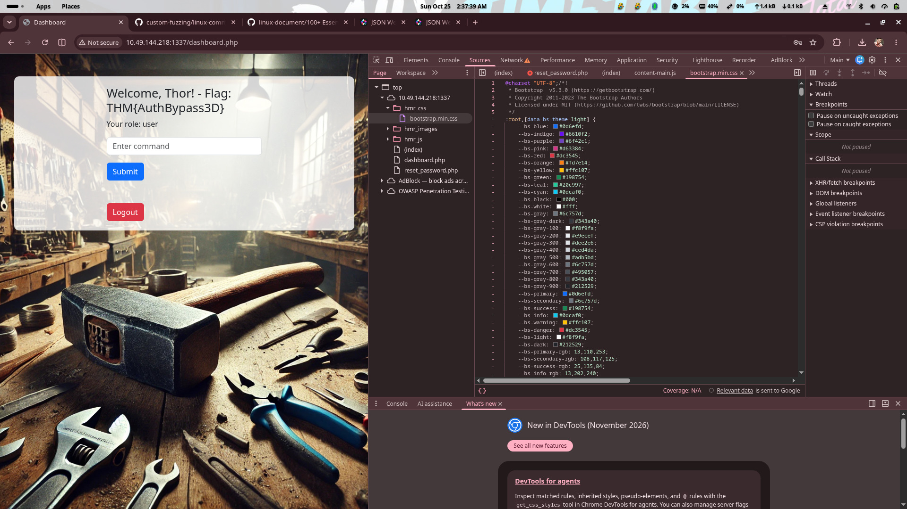

*Figure 13: Alternate capture of the same dashboard view showing the first flag.*

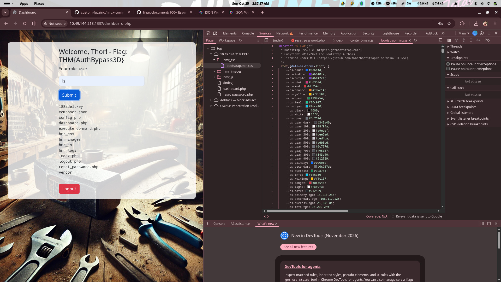

*Figure 14: Additional capture of the dashboard view showing the first flag.*

**Result for objective 1:** `THM{AuthBypass3D}`

This stage demonstrates the impact of weak password-recovery controls: a short numeric recovery code combined with a spoofable rate-limit identity allowed account takeover.

---

## Dashboard Command Functionality

The dashboard contained a command input. The notes report that some commands were restricted and that the session appeared to log out quickly after a command was submitted.

Using the browser's Network panel or an intercepting proxy such as Burp Suite, the request sent to `execute_command.php` was inspected. The observed request used a **bearer JWT** in the `Authorization` header and JSON data containing a `command` field.

The notes also report that changing the request's `persistentSession` value to `yes` made the lab session more stable. This is a challenge-specific observation, not a general authentication recommendation.

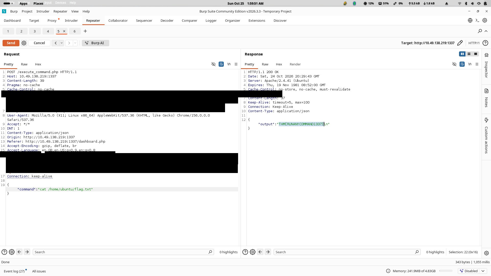

*Figure 5: Burp Suite request showing the `Authorization: Bearer` JWT and session cookie (sensitive values redacted).*

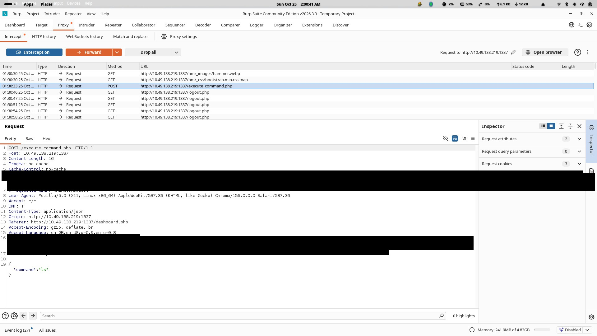

*Figure 6: Detailed view of the same request with the JWT and cookie values redacted.*

This illustrates the difference between client-side restrictions and server-side authorization controls: restrictions observed in the UI did not by themselves prevent the request from being replayed or modified.

---

## JWT Analysis

The notes used a JWT decoder to inspect the token's header and payload. The payload included user data and a **role** claim; the header included an algorithm and a **kid** (key identifier).

The supplied screenshots show an **HS256** token and a key identifier associated with `/var/www/html/188ade1.key`.

Conceptually, the relevant claims looked like this:

```json
{
  "data": {
    "email": "tester@hammer.thm",
    "role": "user"
  }
}
```

The example above is illustrative and intentionally omits token timestamps, user identifiers, signature material, and the actual key.

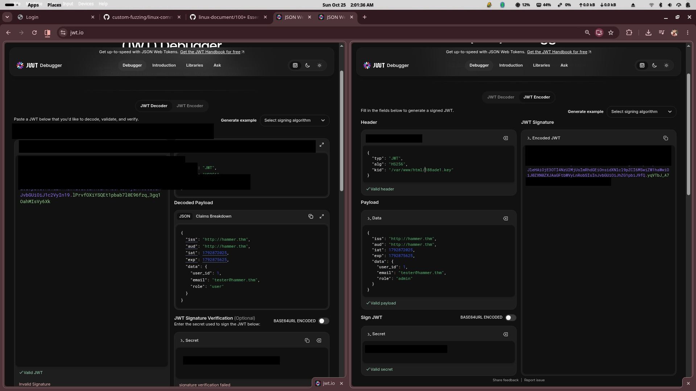

*Figure 8: JWT decoder exposing the signing secret and key identifier (sensitive values redacted).*

Accepting an attacker-controlled key identifier can create a security risk when the application uses it unsafely: an attacker who can influence `kid` and obtain or guess the corresponding key material may be able to forge tokens.

JWT signature verification must be performed securely and authorization claims must not be trusted without validating the token.

---

## Signing-Key Discovery

The command endpoint's response exposed a directory listing that included `188ade1.key`. The notes state that the file contained a signing key and that the key was saved as a text file for inspection.

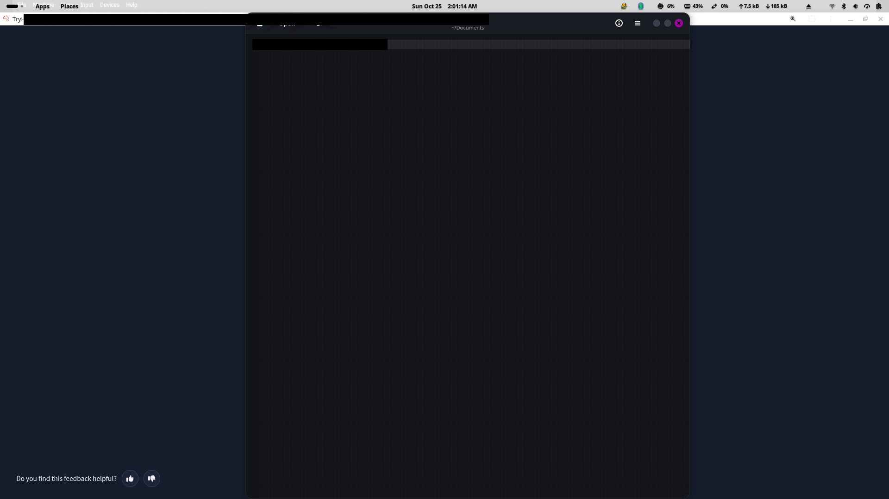

*Figure 7: The exposed `188ade1.key` file containing signing-key material (sensitive values redacted).*

**Finding:** a signing key should never be exposed through a web-accessible path or a command endpoint. Anyone who obtains a JWT signing secret may be able to forge tokens if the application trusts tokens signed with that secret.

> For a public repository, do not commit the actual signing key, a complete live JWT, session cookies, or unredacted proxy captures.

---

## Privilege Escalation — User to Administrator

The notes report the following conceptual sequence:

1. Capture the JWT from an authenticated request.
2. Examine its header and payload.
3. Identify the role claim.
4. Identify the key identifier (`kid`).
5. Analyze the exposed signing-key material.
6. Validate the authorization weakness in the authorized CTF environment.
7. Confirm the resulting administrator-level access.
8. Demonstrate the authorization impact using the supplied evidence.

The token was modified so the **role** claim became `admin`, and the **kid** was changed to reference the discovered key. The modified token was then signed using the exposed key and substituted for the original token in the intercepted request.

**Result reported in the notes:** the application accepted the modified token and granted administrator access.

This is a combination of **key disclosure** and **improper trust in client-presented JWT claims**. A role claim must not be trusted merely because it appears in a decoded token; the server must validate the signature and claims correctly, and signing keys must remain secret.

---

## Second Flag — File Retrieval

With the modified token accepted in the authorized lab, the notes changed the JSON command value from a directory-listing command to a file-read command targeting:

```
/home/ubuntu/flag.txt
```

The request was sent to `execute_command.php`, and the response returned the file contents.

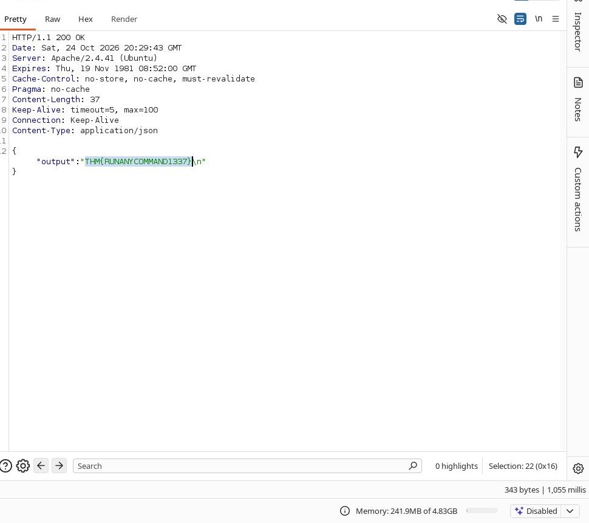

*Figure 15: Intercepted `execute_command.php` response returning the contents of `/home/ubuntu/flag.txt` (flag value visible in the screenshot; transcribe manually if needed).*

The supplied notes do not include the literal value of this second flag, so it is **intentionally not guessed here**. Add the exact value from your successful response before publishing if you want the repository to document both flags. The screenshot above contains the response and can be used to transcribe it.

**Security impact:** once administrator authorization was bypassed, the command endpoint allowed sensitive file access, including `/home/ubuntu/flag.txt`.

---

## Complete Attack Chain

1. Web service discovery on port `1337`.
2. Directory enumeration revealing `hmr_` paths.
3. Sensitive information disclosure through the exposed `hmr_logs/error.logs`.
4. Password-recovery weaknesses (short numeric code, spoofable rate-limit identity).
5. Authentication as the discovered account (`tester@hammer.thm`).
6. Inspection of the dashboard command endpoint (`execute_command.php`).
7. JWT key and authorization analysis (exposed `188ade1.key`, unsafe `kid` handling).
8. Privilege escalation from user to administrator.
9. Retrieval of the second flag from `/home/ubuntu/flag.txt`.

Confirmed observations are distinguished from technical interpretation throughout this report.

---

## Vulnerabilities and Remediation

| Finding | Security impact | Recommended remediation |
|---|---|---|
| Exposed application logs | Information disclosure (account email, internal paths) | Restrict access to logs and prevent public serving of diagnostic files. |
| Weak password-recovery controls | Account takeover risk | Enforce server-side rate limits, strong recovery tokens, and secure recovery workflows. |
| Trust in untrusted forwarding headers | Potential rate-limit bypass | Accept forwarding headers only from explicitly trusted proxies. |
| Exposed signing-key material | Token forgery risk | Remove exposed secrets, rotate affected keys, and store keys securely outside the web root. |
| Unsafe JWT key selection | Potential signature-validation bypass | Use a fixed server-side key-selection policy and validate allowed algorithms. |
| Client-controlled authorization claims | Privilege escalation risk | Validate signed claims and enforce authorization server-side. |
| Unsafe command execution | Potential server compromise | Remove shell execution from web-facing features or use strict allowlists and least privilege. |

Secure JWT verification alone is insufficient if the signing key is exposed. Treat these as remediation recommendations for the corresponding weaknesses, not as proof that every listed issue was independently confirmed.

---

## Lessons Learned

- **Information disclosure:** error logs and key files must not be web-accessible; they can reveal account identifiers and signing material.
- **Authentication and recovery:** short numeric recovery codes and client-spoofable rate-limit identity make automated guessing feasible.
- **Rate limiting:** never trust arbitrary client-supplied forwarding headers for identity; enforce limits server-side using a trusted identity.
- **JWT security:** signing secrets must stay secret; signatures and claims (issuer, audience, expiry, algorithm, `kid`) must be strictly validated; roles must come from trusted server-side authorization data, not client-editable claims.
- **Authorization boundaries:** server-side enforcement is required; client-side restrictions are not a security control.
- **Command-execution risks:** web-facing command execution should be removed or strictly allowlisted with least privilege.
- **Evidence collection:** screenshots and notes should be captured during the engagement to support reproducible, accurate reporting.

---

## Conclusion

The Hammer CTF challenge was completed using authorized lab techniques: port `1337` was identified as the web application, directory discovery exposed `hmr_logs/error.logs` containing a valid account email, the password-reset flow's weak recovery code and spoofable rate-limit identity were exploited to reset the password, and the resulting dashboard displayed the first flag `THM{AuthBypass3D}`. A second-stage weakness involving an exposed signing key and improper JWT validation allowed privilege escalation to administrator, which was then used to read `/home/ubuntu/flag.txt` via the dashboard command endpoint.

The most important lessons are: protect recovery flows with strong, server-enforced rate limiting; never expose signing keys or diagnostic logs; strictly validate JWTs server-side; and avoid exposing arbitrary command execution behind weak authorization. Multiple weaknesses combined into account takeover and privilege escalation, demonstrating the importance of defense in depth.

---

## Disclaimer

This report documents a TryHackMe-style training exercise using the supplied notes and screenshots. The techniques were used only against an authorized lab target and are intended for educational purposes. Use these techniques only in systems for which you have explicit authorization. Verify all target-specific details before publishing. Do not run these techniques against systems without permission.

---

**Evidence files:** `tryhackme/Hammer/screenshots/` (15 images). Raw notes preserved in `tryhackme/Hammer/notes.txt`. Redacted copies were created for screenshots containing secrets; original evidence is retained on the testing machine.