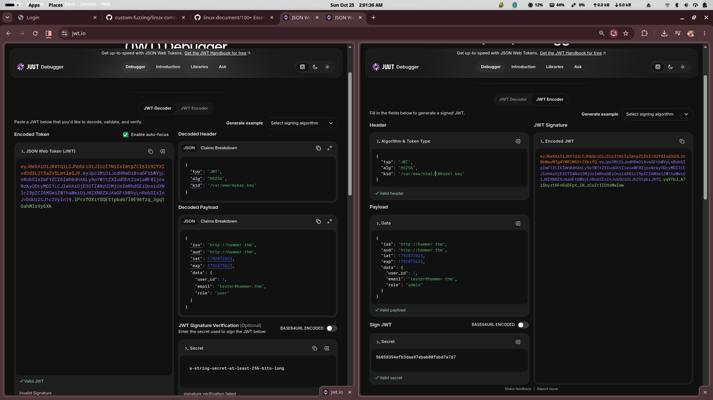
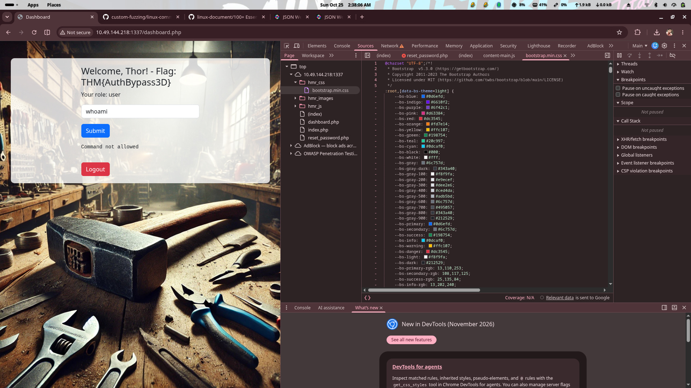

# TryHackMe: Hammer

## 1. Title and challenge overview

**Hammer** is a TryHackMe web application challenge. The target exposes an HTTP service on port `1337`. The challenge path involves web reconnaissance, directory discovery, exposed error logs, password-reset abuse, rate-limit bypass, dashboard access, JWT analysis, signing-key exposure, and command execution leading to `/home/ubuntu/flag.txt`.

## 2. Platform and challenge objectives

- Platform: TryHackMe
- Target service: HTTP on port `1337`
- Objectives: obtain the dashboard flag and retrieve `/home/ubuntu/flag.txt`

## 3. Summary of the attack chain

1. Discover web directories and exposed logs.
2. Identify the reset flow and target email `tester@hammer.thm`.
3. Brute-force the 4-digit recovery code while bypassing rate limiting with `X-Forwarded-For`.
4. Reset the password and log in to the dashboard.
5. Capture the first flag: `THM{AuthBypass3D}`.
6. Intercept the command-execution request in Burp Suite.
7. Analyze and forge an admin JWT using an exposed signing key.
8. Execute `cat /home/ubuntu/flag.txt` and capture the second flag: `THM{RUNANYCOMMAND1337}`.

## 4. Reconnaissance and Nmap enumeration

The supplied evidence does not include a captured Nmap scan. The web service was identified on port `1337` during manual browsing. Treat any port/service identification as an observed lab step rather than a preserved scan output.

## 5. Web application discovery on port 1337

The application provides login, password reset, dashboard, and command execution functionality. The target IP is lab-specific and temporary.

## 6. Directory enumeration and exposed error logs

A wordlist was prepared and used with `dirsearch`:

```bash
sed 's/^/hmr_/' big.txt > hmr_big.txt
dirsearch --url http://<target-ip>:1337 -w /home/shivam/hmr_big.txt
```

Discovered directories included:

- `/hmr_css/`
- `/hmr_images/`
- `/hmr_js/`
- `/hmr_logs/`

The error log at `/hmr_logs/error.log` exposed Apache errors and references to paths such as `/restricted-area`, `/admin-login`, `/var/www/html/`, and `/home/hammer/test.php`.


*Figure 2: Directory discovery and Apache error-log exposure.*



*Figure 3: Additional error-log and path disclosure evidence.*

## 7. Discovery of `tester@hammer.thm`

The reset flow is initiated from the login page via **Forgot your password?**. The reset page is `reset_password.php` and accepts a 4-digit recovery code within a time limit.


*Figure 1: Application login page.*

## 8. Password-reset workflow and recovery-code behavior

The reset code was brute-forced with a Python script (`hammer.py`) using 50 threads. The script sends the initial reset request for `tester@hammer.thm`, then tries all 4-digit codes.

Observed successful output:

```text
[+] Sending the password reset request.
[+] Starting the code brute-force.
[+] Found the recovery code: [REDACTED]
[+] Sending the new password request.
[+] Password is set to [REDACTED]
```

## 9. Rate-limit weakness and the role of `X-Forwarded-For`

Rate limiting was bypassed by rotating the `X-Forwarded-For` header across `127.0.0.1` to `127.0.255.255`. The response header `Rate-Limit-Pending` was observed (value `6` in one capture). This indicates the application trusted a client-controlled forwarding header for rate limiting.

## 10. Password reset and successful dashboard login

Recovered credentials were used to log in:

- Email: `tester@hammer.thm`
- Password: `[REDACTED]`

## 11. First flag

After login, the dashboard greets the user and displays the first flag:

- URL: `http://<target-ip>:1337/dashboard.php`
- Welcome: `Welcome, Thor! - Flag: THM{AuthBypass3D}`
- Role: `user`
- Command input accepts commands such as `ls` or `whoami`; restricted commands return `Command not allowed`.

**Flag 1:** `THM{AuthBypass3D}`



*Figure 4: Successful dashboard login and first flag.*

## 12. Dashboard command endpoint analysis

The endpoint `/execute_command.php` accepts JSON:

```json
{"command":"ls"}
```

Restricted commands are rejected with `Command not allowed`. A valid session (`PHPSESSID`) and JWT (`token` cookie / `Authorization: Bearer ...`) are required.

## 13. HTTP request interception using Burp Suite

Burp Suite Proxy/Repeater was used to inspect and replay requests to `/execute_command.php`, including modifying the `Authorization` header and `token` cookie.

## 14. JWT header and payload analysis

The JWT header uses `alg: HS256` and a `kid` pointing to a local key file. Observed `kid` values:

- `/var/www/mykey.key`
- `/var/www/html/188ade1.key`

## 15. Exposed signing-key discovery

A key file contained a 32-hex-character signing secret. The value is redacted for publication. It was used with jwt.io to forge a new JWT with `role: admin`.

## 16. JWT authorization weakness and administrator access

The forged admin JWT was placed in the `Authorization` header and `token` cookie. This granted administrative command execution, indicating improper JWT validation and role enforcement.

## 17. Retrieval of `/home/ubuntu/flag.txt`

With the forged admin JWT, the following request was sent via Burp Repeater:

```http
POST /execute_command.php HTTP/1.1
Host: <target-ip>:1337
Content-Type: application/json
Authorization: Bearer [REDACTED]

{"command":"cat /home/ubuntu/flag.txt"}
```

Response:

```json
{"output":"THM{RUNANYCOMMAND1337}\n"}
```

**Flag 2:** `THM{RUNANYCOMMAND1337}`


*Figure 5: Command execution response containing the second flag (request tokens redacted).*

## 18. Final results and attack-chain summary

- Flag 1: `THM{AuthBypass3D}`
- Flag 2: `THM{RUNANYCOMMAND1337}`
- Attack chain: reconnaissance → directory discovery → log exposure → password reset abuse → rate-limit bypass → JWT key exposure → privilege escalation → command execution.

## 19. Vulnerability analysis and remediation recommendations

- Exposure of diagnostic logs: restrict access to `/hmr_logs/` and avoid verbose error output in production.
- Weak recovery-code protections: use strong, unpredictable codes and secure delivery; add backoff and account lockout.
- Trusting client-controlled forwarding headers for rate limiting: derive client identity from trusted proxy layers only.
- Exposure of a JWT signing key: store keys outside web root and restrict permissions.
- Improper JWT authorization or role validation: validate algorithm, issuer, audience, expiry, and enforce server-side authorization.
- Excessive command-execution privileges: remove or strictly restrict command execution endpoints.

## 20. Lessons learned

- Logs can leak sensitive paths and implementation details.
- Rate limiting must not trust spoofable headers.
- JWT `kid` and signing-key exposure can lead to full privilege escalation.
- Client-side role checks are not a security boundary.

## 21. Evidence and screenshot references

- `screenshots/01-login-page.jpg` — Login page.
- `screenshots/02-directory-enumeration.jpg` — Directory discovery and exposed logs.
- `screenshots/03-error-log-discovery.jpg` — Error-log disclosure.
- `screenshots/04-dashboard-first-flag.jpg` — Dashboard and first flag.
- `screenshots/05-command-execution-flag.jpg` — Command execution and second flag.

## References

- TryHackMe Hammer room.
- Observed endpoints: `/`, `/login`, `/reset_password.php`, `/dashboard.php`, `/execute_command.php`, `/logout.php`, `/hmr_logs/error.log`.
path: /home/shivam/ctf-writeups/tryhackme/Hammer/README.md