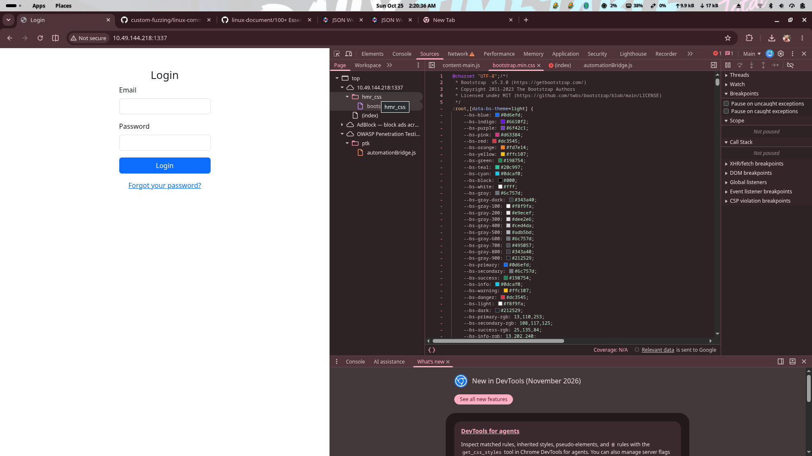
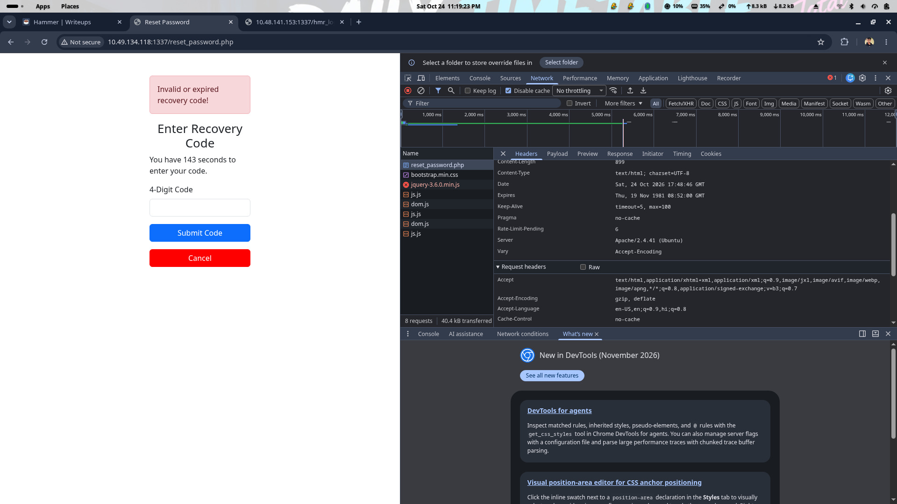

# Hammer — TryHackMe CTF Walkthrough

## Overview

- **Platform:** TryHackMe
- **Challenge:** Hammer
- **Category:** Web application security
- **Objective:** Obtain the dashboard flag and retrieve the contents of `/home/ubuntu/flag.txt`.
- **Scope:** Authorized CTF lab environment only.

## Table of Contents

1. [Initial Reconnaissance](#1-initial-reconnaissance)
2. [Web Application Enumeration](#2-web-application-enumeration)
3. [Password Recovery Analysis](#3-password-recovery-analysis)
4. [First Flag — Dashboard Authentication](#4-first-flag--dashboard-authentication)
5. [Dashboard Command Interface](#5-dashboard-command-interface)
6. [Signing-Key Discovery](#6-signing-key-discovery)
7. [JWT Analysis](#7-jwt-analysis)
8. [Privilege Escalation](#8-privilege-escalation)
9. [Second Flag — File Retrieval](#9-second-flag--file-retrieval)
10. [Vulnerabilities Identified](#10-vulnerabilities-identified)
11. [Lessons Learned](#11-lessons-learned)
12. [Remediation](#12-remediation)
13. [Conclusion](#13-conclusion)
14. [Disclaimer](#14-disclaimer)

---

## 1. Initial Reconnaissance

The lab machine was scanned with Nmap to identify open services. The supplied notes report **three open ports**, with port `1337` standing out as the likely web application. Port `1337` was therefore investigated further.

```bash
nmap -sC -sV -oN nmap-initial.txt <TARGET_IP>
```

- `-sC` runs Nmap's default scripts.
- `-sV` attempts to identify service versions.
- `-oN` saves the results to a text file.

**Observation:** Port `1337` was identified as the web application entry point and was used for all subsequent web testing. Replace `<TARGET_IP>` with the IP assigned to your own TryHackMe instance; do not target systems without authorization.

## 2. Web Application Enumeration

Browsing to `http://<TARGET_IP>:1337/` presented a login page and a **Forgot your password?** link. Inspecting the page source revealed resource paths beginning with `hmr_`, which provided a useful lead for content discovery.


*Login page served on port 1337, showing the "Forgot your password?" link and the `hmr_` resource naming pattern in the source.*

### Directory discovery

A directory-discovery tool was run against the web service:

```bash
dirsearch -u http://<TARGET_IP>:1337/ -w <WORDLIST_PATH>
```

The notes report discovery of the following paths:

- `/hmr_css`
- `/hmr_images`
- `/hmr_js`
- `/hmr_logs`

### Exposed error log

Browsing the discovered paths revealed `hmr_logs/error.logs`, which contained application error messages and the account email address:

```
tester@hammer.thm
```


*dirsearch results revealing the `hmr_` paths and the exposed `hmr_logs/error.logs` containing the account email and internal path details.*

**Why this mattered:** the log disclosure revealed a valid account identifier that could be used in the password-reset workflow. Error logs should not be publicly accessible in a production application.


*Browser DevTools sources view used while inspecting the application's `hmr_` resources.*

## 3. Password Recovery Analysis

### Discovered account

The email discovered in the error log was:

```
tester@hammer.thm
```

### Recovery page

Returning to the login page, selecting **Forgot your password?**, and submitting the discovered email started the password-reset flow. The reset page requested a **four-digit recovery code** and displayed a countdown of roughly **180 seconds**.


*Reset page requesting the four-digit recovery code with the ~180-second countdown.*

### Rate-limit investigation

Submitting a test code and inspecting the request in the browser's Developer Tools Network panel showed the request was handled by `reset_password.php`. The supplied notes report a rate-limit allowance of **nine attempts**.


*Browser DevTools Network tab showing the `reset_password.php` request and rate-limit headers (sensitive values redacted).*

This indicated two constraints to investigate in the authorized lab:

- The recovery code had a short validity period.
- Repeated guesses were rate limited.

### Rate-limit bypass and recovery-code brute force

The notes describe a Python script that submitted candidate four-digit codes and varied the `X-Forwarded-For` request header within the `127.0.0.0/8` range. The target accepted this header for rate-limit accounting, allowing the challenge's rate limit to be bypassed. The script completed before the recovery-code window expired and set the new password to `Password123`.

**Result reported in the notes:** the script found the recovery code, and the password was reset successfully.

**Security lesson:** `X-Forwarded-For` is user-controllable unless a trusted reverse proxy removes and rewrites it. Applications must not trust arbitrary client-supplied forwarding headers to determine rate-limit identity. Apply limits using a trusted client identity and account-level controls, and add monitoring and lockout protections appropriate to the threat model.

> For a public write-up, avoid publishing a reusable brute-force script or a live recovery code. The flaw and the observed result are explained here; any exploit implementation should remain limited to the isolated CTF environment.

## 4. First Flag — Dashboard Authentication

Returning to the login page and authenticating with:

- **Email:** `tester@hammer.thm`
- **Password:** `Password123` (the password set during the lab workflow)

The dashboard welcomed the user as **Thor** and displayed the first flag:

```
THM{AuthBypass3D}
```


*Dashboard greeting Thor and displaying `THM{AuthBypass3D}`.*

**Result for objective 1:** `THM{AuthBypass3D}`

## 5. Dashboard Command Interface

The dashboard contained a command input. The notes report that some commands were restricted and that the session appeared to log out quickly after a command was submitted.

Using the browser's Network panel or an intercepting proxy such as Burp Suite, the request sent to `execute_command.php` was inspected. The observed request used a **bearer JWT** in the `Authorization` header and JSON data containing a `command` field.

The notes also report that changing the request's `persistentSession` value to `yes` made the lab session more stable. This is a challenge-specific observation, not a general authentication recommendation.

## 6. Signing-Key Discovery

The command endpoint's response exposed a directory listing that included `188ade1.key`. The notes state that the file contained a signing key and that the key was saved as a text file for inspection.

**Finding:** a signing key should never be exposed through a web-accessible path or a command endpoint. Anyone who obtains a JWT signing secret may be able to forge tokens if the application trusts tokens signed with that secret.

> For a public repository, do not commit the actual signing key, a complete live JWT, session cookies, or unredacted proxy captures.

## 7. JWT Analysis

The notes used a JWT decoder to inspect the token's header and payload. The payload included user data and a **role** claim; the header included an algorithm and a **kid** (key identifier).

Conceptually, the relevant claims looked like this:

```json
{
  "data": {
    "email": "tester@hammer.thm",
    "role": "user"
  }
}
```

The example above is illustrative and intentionally omits token timestamps, user identifiers, signature material, and the actual key.

## 8. Privilege Escalation

The notes report that the token was modified so the **role** claim became `admin`, and the **kid** was changed to reference the discovered key. The modified token was then signed using the exposed key and substituted for the original token in the intercepted request.

**Result reported in the notes:** the application accepted the modified token and granted administrator access.

This is a combination of **key disclosure** and **improper trust in client-presented JWT claims**. A role claim must not be trusted merely because it appears in a decoded token; the server must validate the signature and claims correctly, and signing keys must remain secret.

## 9. Second Flag — File Retrieval

With the modified token accepted in the authorized lab, the notes changed the JSON command value from a directory-listing command to a file-read command targeting:

```
/home/ubuntu/flag.txt
```

The request was sent to `execute_command.php`, and the response returned the file contents.


*Intercepted `execute_command.php` response returning the contents of `/home/ubuntu/flag.txt` (flag value visible in the screenshot; transcribe manually if needed).*

The supplied notes do not include the literal value of this second flag, so it is **intentionally not guessed here**. Add the exact value from your successful response before publishing if you want the repository to document both flags. The screenshot above contains the response and can be used to transcribe it.

**Security impact:** once administrator authorization was bypassed, the command endpoint allowed sensitive file access, including `/home/ubuntu/flag.txt`.

## 10. Vulnerabilities Identified

| Finding | Evidence | Security impact | Recommended remediation |
|---|---|---|---|
| Insufficient protection of password recovery against brute force | Four-digit recovery code with ~180s validity and nine-attempt allowance | Automated guessing of recovery codes becomes feasible | Use sufficiently unpredictable, short-lived recovery tokens; enforce per-account and per-source throttling |
| Trust in attacker-controlled forwarding headers for rate limiting | `X-Forwarded-For` accepted for rate-limit identity within `127.0.0.0/8` | Rate limits bypassed by spoofing the forwarding header | Trust `X-Forwarded-For` only when inserted by a configured trusted proxy; use trusted client identity |
| Exposure of sensitive information through accessible logs/files | `hmr_logs/error.logs` exposed account email and application details; `188ade1.key` exposed | Account enumeration and signing-key disclosure enabling token forgery | Keep logs, config, and signing keys outside the web root; deny direct web access to diagnostic files |
| Weak protection of signing keys | Signing key accessible through the application workflow | Anyone obtaining the secret can forge JWTs | Store JWT signing secrets securely; rotate compromised keys |
| Improper JWT signature/key-selection validation | Modified role claim and `kid` accepted after re-signing with the exposed key | Privilege escalation to administrator | Validate JWT signatures and claims server-side; strict allowlist of algorithms; resolve roles from trusted server-side data |
| Missing/inadequate server-side authorization on command execution | Command endpoint executed arbitrary OS commands after token acceptance | Sensitive file read (`/home/ubuntu/flag.txt`) | Restrict command execution to an explicit allowlist of safe operations; run with least privilege |
| Excessive privileges granted through manipulated claims | Role claim trusted from a client-editable token | Unauthorized administrator access | Do not trust client-editable role claims; enforce authorization server-side |

## 11. Lessons Learned

- **Authentication:** short numeric recovery codes and client-spoofable rate-limit identity make automated guessing feasible.
- **Rate limiting:** never trust arbitrary client-supplied forwarding headers for identity; enforce limits server-side using a trusted identity.
- **Secret management:** logs, configuration files, and signing keys must not be web-accessible; rotate any secret that may have been exposed.
- **JWT security:** signing secrets must stay secret; signatures and claims (issuer, audience, expiry, algorithm, `kid`) must be strictly validated; roles must come from trusted server-side authorization data, not client-editable claims.
- **Server-side authorization:** command execution endpoints must not expose arbitrary operating-system commands; use allowlists and least privilege.
- **Monitoring:** add regression tests and alerting for rate-limit bypass, unauthorized role changes, key-file access, and command-endpoint authorization.

## 12. Remediation

Actionable defensive recommendations:

- Keep logs, configuration files, and signing keys outside the web root; deny direct web access to diagnostic files.
- Remove sensitive values from error messages and rotate any secret that may have been exposed.
- Use sufficiently unpredictable, short-lived recovery tokens; enforce per-account and per-source throttling on the server; add abuse monitoring and invalidate reset tokens after use.
- Trust `X-Forwarded-For` only when it is inserted by a configured trusted proxy. Do not let arbitrary clients choose their rate-limit identity.
- Store JWT signing secrets securely, rotate compromised keys, and use a strict allowlist of accepted algorithms.
- Validate JWT signatures and relevant claims server-side. Resolve roles from trusted server-side authorization data rather than trusting a client-editable role claim.
- Restrict command execution to an explicit allowlist of safe operations, run with least privilege, and avoid exposing arbitrary operating-system commands through a web dashboard.
- Add regression tests for rate-limit bypass, unauthorized role changes, key-file access, and command-endpoint authorization.
- Add logging and alerting for suspicious authentication and authorization activity.

## 13. Conclusion

The Hammer CTF challenge was completed using authorized lab techniques: port `1337` was identified as the web application, directory discovery exposed `hmr_logs/error.logs` containing a valid account email, the password-reset flow's weak recovery code and spoofable rate-limit identity were exploited to reset the password, and the resulting dashboard displayed the first flag `THM{AuthBypass3D}`. A second-stage weakness involving an exposed signing key and improper JWT validation allowed privilege escalation to administrator, which was then used to read `/home/ubuntu/flag.txt` via the dashboard command endpoint.

The most important lessons are: protect recovery flows with strong, server-enforced rate limiting; never expose signing keys or diagnostic logs; strictly validate JWTs server-side; and avoid exposing arbitrary command execution behind weak authorization.

## 14. Disclaimer

This report documents a TryHackMe-style training exercise using the supplied notes and screenshots. The techniques were used only against an authorized lab target and are intended for educational purposes. Use these techniques only in systems for which you have explicit authorization. Verify all target-specific details before publishing. Do not run these techniques against systems without permission.

---

**Evidence files:** `tryhackme/Hammer/screenshots/` (7 images). Raw notes preserved in `tryhackme/Hammer/notes.txt`.